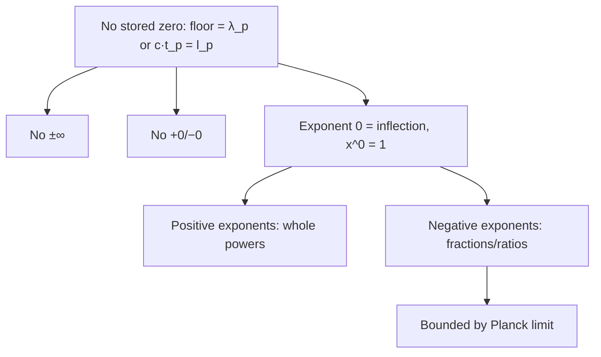

# Session Pattern Map Addendum — No Zero, No Infinity, Exponent-0 Inflection

Date: Saturday 2026-10-24, 4:00–4:07 PM ET (UTC-4)
Owner: Timothy Norman (Rex)
Parent: SESSION_PATTERN_MAP_2026-10-24_CORTEX_8X6.md (sha256 00c526ec872c862da916658f784f37a42bf0a6250cdc61a9bfe8c6c998da09af)
Mode: append-only; parent not modified.

## Items

- 4:00 Zero floor: in place of a stored 0, the start/stop floor is λ_p or any combination converting to l_p, e.g. c·t_p = l_p.
- 4:01 No ±∞: none of the 36 earned rules in /workspace/equation-scratch-pad/EARNED_EQUATIONS.jsonl uses infinity; bounded ceiling.
- 4:02 No +0/−0: floor is always positive and math is exact integers/fractions (no Float64), so signed zero cannot arise.
- 4:03 Exponent 0 is the inflection point: x^0 = 1; positive exponents = whole powers; negative exponents flip into fractions/ratios (x^−n = 1/x^n), bounded by Planck limit, never reaching zero.
- Open item: stored zeros remain in earned-rule seeds/boundaries (correction 16: line 10 D(1)=0, line 17 seeds [1,0], lines 15/26/34 seeds [0,1], lines 2–5 'T=0 outside triangle'); λ_p floor test pending Timothy's yes.

## Map

