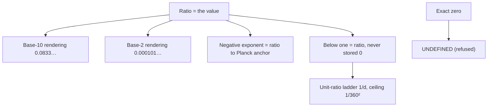

# SESSION PATTERN MAP 2026-10-26 — Ratios Are Values, Fractions Are Renderings
Generated: 2026-10-26T13:43:03-04:00 (America/New_York). Owner: Timothy Norman. Mode: append-only; parent map SESSION_PATTERN_MAP_2026-10-26_TRUNCATION_EV2.md (sha256 d6c9edfb723ef8a700c342776e7eeb2169f2a09a0a4057f09ae879452e07585d) not modified.

## Pattern match 1 (13:31–13:42 ET)
- 13:31 Below One as Fraction added (spec rev5 dbd4e856…1809).
- 13:32 Renamed Below One as Ratio (rev6 166351971a70…5ba2); geometry.py stores sub-unit magnitudes as exact ratios, zero refused UNDEFINED; unit_ratio_floor (1/d ladder, ceiling 1/360², truncation toward zero) -> 5bb42f0e…60d2 (supersedes f34514be…3e1d).
- 13:39 test_deconcat.py updated to expect ratios -> ee39932d…18eb (supersedes fae488e9…6ae4); 13/13 PASS.
- 13:42 Ratios Are the Values, Fractions Are Renderings (rev7).
- Pattern: same move each time — a value is a ratio; zero is never stored; renderings (decimal digits, base-2 digits) are views of the ratio.

## Map

## Audit (hashes verified against Timothy's list, all HIT before rev7)
| file | given sha256 | on disk before rev7 |
|---|---|---|
| TRUNCATION_SPEC_2026-10-26.md | 166351971a70a58626e52f6ab3bd63a77ee8ff5cc17b03e1e328d3346ea35ba2 | HIT |
| test_deconcat.py | ee39932dc7474d20098b378c18c3462b3c01dd8675e131eaecd5c61e00e018eb | HIT |
| MANIFEST_SPEC_APPEND.sha256 | cbcb753b43122d528b283ddcf23f39c9fe0a157d1eff9eabae4c5312e15c3cb0 | HIT |
| geometry.py | 5bb42f0ef90978667e179e050df4badeeeb8966c453bde191e974283f8f860d2 | HIT |

After rev7 (13:42:45 ET):
- TRUNCATION_SPEC_2026-10-26.md: e0b1197d7da23fce1789c5bbab0a62ad52ae01b0e5d108f644b48054c2f2310a (4557 bytes), supersedes 166351971a70…5ba2
- MANIFEST_SPEC_APPEND.sha256: 6d9b5baf7008d2b66168831a3b717d549057486c3baa584523b2be452ffeb073, supersedes cbcb753b…c3cb0
- test_deconcat.py: ee39932dc7474d20098b378c18c3462b3c01dd8675e131eaecd5c61e00e018eb (unchanged)
- geometry.py: 5bb42f0ef90978667e179e050df4badeeeb8966c453bde191e974283f8f860d2 (unchanged)
- Tests: test_deconcat 13/13, test_below_one_ratio 17/17, repo unittest 10/10, lattice suite 33/33 (own shim).

## Pattern match 2
Rule chain is consistent: negative exponent as ratio, below one as ratio, ratios are values. No conflicts found with no-stored-zero, truncate-never-round, or e-45 master string.

## Open
- 0.0833 truncates to 833/10000 (ladder 1/13), not 1/12; 1/12 must be entered as a ratio.
- geometry.py has no base-2 rendering function yet (rule recorded only).
- Carried: 2.758 origin; Planck-side form; instrument provenance UNVERIFIED; literal-exponent text in code; ring L-shape vs border; 48-cell set; Dec 2025 brief; rest of tims-session-archive.

## Context note (appended 2026-10-26T13:46:49-04:00)
This work was finished just before 4.2 miles on I-95 North, heading for exit 18E, about four miles off. Revision supersedes sha256 182e9fe5ec35ad777ccb85a629a605b8a5f5f8658cb36dbaf76a707df248c7d1. SVCT record: this file is job-scoped; the note is part of the session's provenance.
